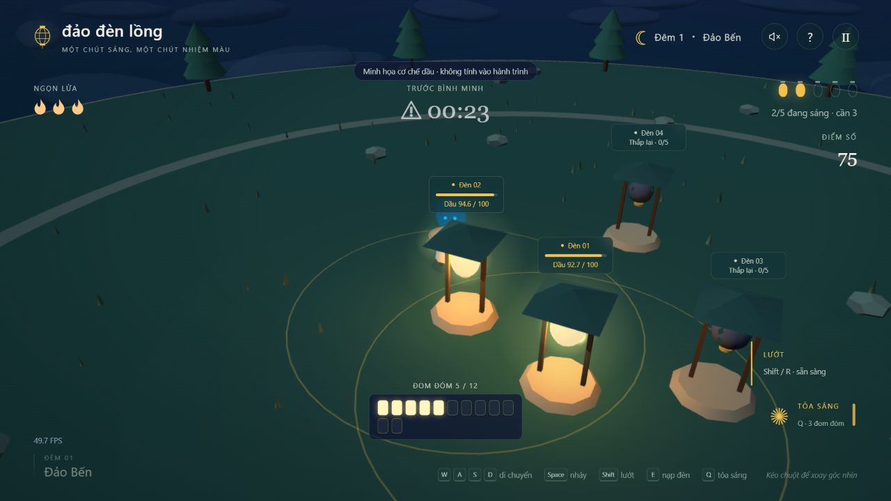
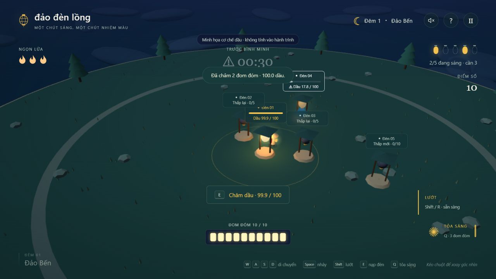
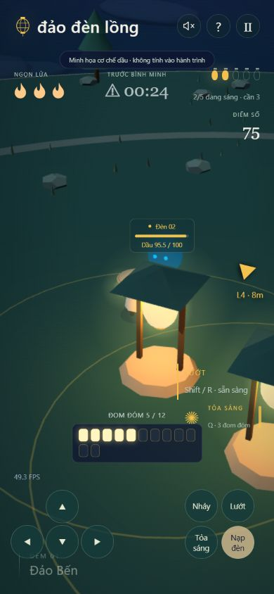

# Bằng chứng Phase 3 — Contract1.2

Lệnh thực tế: `npm.cmd run verify` trên Windows, Node v26.13.1. [verification.json](verification.json) lưu exit code, stdout/stderr, hash nguồn và kết quả từng case.

- 61/61 test đạt;0 fail,0 skip. Build web tĩnh đạt.
- 28 tình huống CLI chạy hai lần, JSONL giống từng byte. Fixtures công khai ở `tests/scenarios/phase-3/`.
- Ba replay maintain-night chạy đủ14400/16200/18000 bước, thắng tại bình minh. **Đây là scenario dựng sẵn**, không phải ba lượt chơi màn mặc định: bố trí đèn/đom đóm và tắt ngẫu nhiên để kiểm tra expiry/relight/capacity và luật kết thúc trong cả Đêm.
- Benchmark CLI gồm I/O: cả ba Đêm dưới30s, chạy đủ thời lượng từng Đêm với scenario nhiều lửa; thời gian cụ thể của lần chạy mới nhất ở [benchmark.json](benchmark.json). Kết quả lost tại dawn là đúng vì không duy trì đèn; không phải playthrough thắng.

|Yêu cầu|Bằng chứng|
|---|---|
|Dầu nguyên, cạn trước tương tác, relight5|tests/fuel.test.mjs; expiry-relight.jsonl|
|Châm ceil/clamp, bỏ đèn đầy, gần nhất/id|tests/fuel.test.mjs; refuel-ceil.jsonl|
|Biên30, phục hồi vùng an toàn|tests/fuel.test.mjs; safe-restored.jsonl|
|Wander chọn yếu, drain cộng dồn, pulse15|tests/fuel.test.mjs; multi-drain.jsonl; drain-pulse.jsonl|
|Pause đóng băng dầu/cadence|pause-fuel.jsonl; regression-pause.jsonl|
|Túi10→20, đèn preset không tăng|tests/fuel.test.mjs; capacity-grow.jsonl|
|Không thắng sớm|no-early-win.jsonl|
|Ngưỡng cả ba Đêm, điểm mới|dawn-win-1/2/3.jsonl; dawn-lose-1/2/3.jsonl|
|Tick cuối tắt đèn/hết lửa|final-tick-out.jsonl; final-tick-no-flames.jsonl|
|Giữ luật Phase1/2 còn hiệu lực|regression dash/charm/drifter/fall/bridge-pad/upper-pad/ramp/wind; unit/CLI/campaign|
|HUD, màu lưu, xẹp/rách, cảnh báo|[browser-checks.md](browser-checks.md), ảnh bên dưới|
|ADR và thay test có lý do|docs/adr/003-fuel-and-dawn.md; CHANGELOG.md|

Giới hạn: chưa có test ẩn/CI OS đích; chưa chơi thủ công thắng cả3 Đêm mặc định. Ảnh không tự chứng minh tốc độ1Hz: browser kiểm tra animation thực tế có duration1s, world dùng chu kỳ1s và test lõi kiểm tra biên dầu. Proof cũ giữ nguyên. Bản triển khai ban đầu không commit; chỉ thị tiếp theo của người dùng đã cho phép công bố ba phase cùng tag tương ứng.
